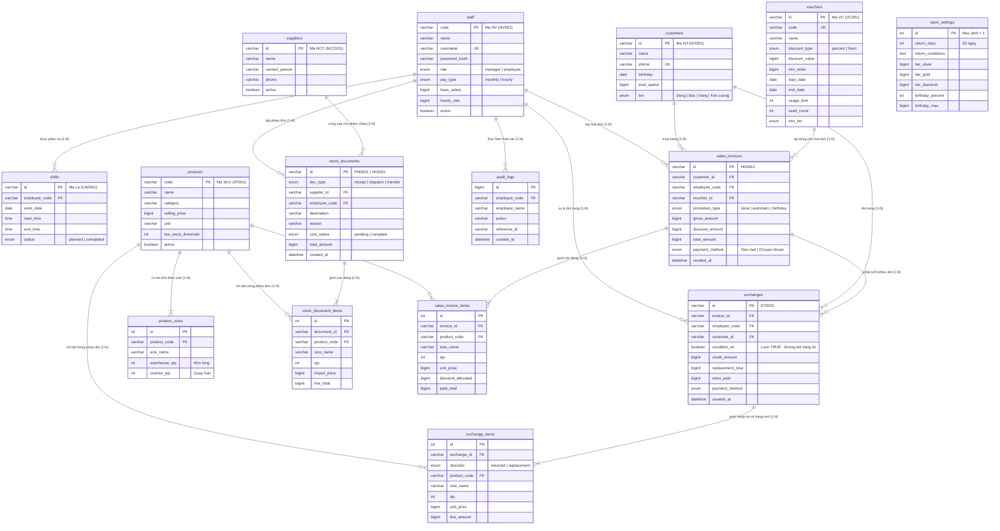

# THIẾT KẾ CƠ SỞ DỮ LIỆU & SƠ ĐỒ ERD (MYSQL)

Tài liệu mô tả chi tiết mô hình thực thể kết hợp (**ERD**) và cấu trúc **15 bảng MySQL** cho hệ thống **Quản lý cửa hàng thời trang Atino**, bám sát 10 nhóm chức năng đã chốt.

> **Điểm nhấn thiết kế đã chốt:**
> 1. Bảng `product_sizes` quản lý tồn kho theo từng Size của từng SKU và **chỉ có 2 cột số lượng**: `warehouse_qty` (**Kho tổng**) và `counter_qty` (**Quầy bán**). **Không có cột `held_qty` (hàng lỗi chờ xử lý).**
> 2. Bảng `exchanges` chỉ cho phép đổi **hàng đạt tiêu chuẩn** (`condition_ok = TRUE`), **không cho đổi hàng lỗi**.

---

## 1. Sơ đồ ERD trực quan

Xem ảnh sơ đồ đầy đủ tại [erd-atino.png](./erd-atino.png) (hoặc bản Word kèm giải thích tại [ERD-ATINO.docx](./ERD-ATINO.docx)).

---

## 2. Chi tiết các bảng & Ràng buộc MySQL

### Nhóm 1: Nhân sự & Phân quyền
1. **`staff`** — Nhân viên & tài khoản đăng nhập
   - `code` `VARCHAR(20) PRIMARY KEY` (vd: `NV001`)
   - `name` `VARCHAR(100) NOT NULL`
   - `username` `VARCHAR(50) NOT NULL UNIQUE`
   - `password_hash` `VARCHAR(255) NOT NULL`
   - `role` `ENUM('manager', 'employee') NOT NULL`
   - `phone` `VARCHAR(25) NULL`
   - `job_title` `VARCHAR(100) NULL`
   - `pay_type` `ENUM('monthly', 'hourly') NOT NULL DEFAULT 'monthly'`
   - `base_salary` `BIGINT NOT NULL DEFAULT 0`
   - `hourly_rate` `BIGINT NOT NULL DEFAULT 0`
   - `start_date` `DATE NULL`
   - `default_shift` `VARCHAR(120) NULL`
   - `active` `BOOLEAN NOT NULL DEFAULT TRUE`
   - `created_at` `DATETIME NOT NULL DEFAULT CURRENT_TIMESTAMP`

2. **`shifts`** — Lịch phân ca làm việc
   - `id` `VARCHAR(20) PRIMARY KEY` (vd: `CA0001`)
   - `employee_code` `VARCHAR(20) NOT NULL` (`FK -> staff.code`)
   - `work_date` `DATE NOT NULL`
   - `start_time` `TIME NOT NULL`
   - `end_time` `TIME NOT NULL`
   - `status` `ENUM('planned', 'completed') NOT NULL DEFAULT 'planned'`
   - `note` `VARCHAR(500) NULL`
   - `created_at` `DATETIME NOT NULL DEFAULT CURRENT_TIMESTAMP`

### Nhóm 2: Hàng hóa, Tồn kho theo Size & Nhà cung cấp
3. **`suppliers`** — Nhà cung cấp
   - `id` `VARCHAR(20) PRIMARY KEY` (vd: `NCC001`)
   - `name` `VARCHAR(150) NOT NULL`
   - `contact_person` `VARCHAR(100) NULL`
   - `phone` `VARCHAR(25) NULL`
   - `email` `VARCHAR(150) NULL`
   - `address` `VARCHAR(300) NULL`
   - `note` `TEXT NULL`
   - `active` `BOOLEAN NOT NULL DEFAULT TRUE`

4. **`products`** — Sản phẩm
   - `code` `VARCHAR(30) PRIMARY KEY` (vd: `AT001`, `QJ001`)
   - `name` `VARCHAR(150) NOT NULL`
   - `category` `VARCHAR(60) NOT NULL`
   - `selling_price` `BIGINT NOT NULL`
   - `unit` `VARCHAR(30) NOT NULL DEFAULT 'sản phẩm'`
   - `description` `TEXT NULL`
   - `low_stock_threshold` `INT NOT NULL DEFAULT 2`
   - `slow_moving_note` `VARCHAR(300) NULL`
   - `active` `BOOLEAN NOT NULL DEFAULT TRUE`
   - `created_at` `DATETIME NOT NULL DEFAULT CURRENT_TIMESTAMP`

5. **`product_sizes`** — Tồn kho chi tiết theo Size (Chỉ Kho tổng & Quầy bán)
   - `id` `INT AUTO_INCREMENT PRIMARY KEY`
   - `product_code` `VARCHAR(30) NOT NULL` (`FK -> products.code`)
   - `size_name` `VARCHAR(40) NOT NULL`
   - `warehouse_qty` `INT NOT NULL DEFAULT 0` (Kho tổng)
   - `counter_qty` `INT NOT NULL DEFAULT 0` (Quầy bán)
   - `UNIQUE KEY uq_product_size (product_code, size_name)`
   - `CHECK (warehouse_qty >= 0 AND counter_qty >= 0)`

6. **`stock_documents`** — Phiếu Nhập / Xuất / Điều chuyển kho
   - `id` `VARCHAR(20) PRIMARY KEY` (`PN0001`, `XK0001`, `DC0001`)
   - `doc_type` `ENUM('receipt', 'dispatch', 'transfer') NOT NULL`
   - `direction` `ENUM('toCounter', 'toWarehouse') NULL` (dùng khi `doc_type = 'transfer'`)
   - `supplier_id` `VARCHAR(20) NULL` (`FK -> suppliers.id`, dùng khi `doc_type = 'receipt'`)
   - `employee_code` `VARCHAR(20) NOT NULL` (`FK -> staff.code`)
   - `destination` `VARCHAR(200) NULL` (nơi nhận khi xuất kho)
   - `reason` `VARCHAR(300) NULL` (lý do xuất kho)
   - `cost_status` `ENUM('pending', 'complete') NOT NULL DEFAULT 'complete'`
   - `total_amount` `BIGINT NULL`
   - `note` `TEXT NULL`
   - `created_at` `DATETIME NOT NULL DEFAULT CURRENT_TIMESTAMP`

7. **`stock_document_items`** — Chi tiết dòng phiếu kho
   - `id` `INT AUTO_INCREMENT PRIMARY KEY`
   - `document_id` `VARCHAR(20) NOT NULL` (`FK -> stock_documents.id`)
   - `product_code` `VARCHAR(30) NOT NULL` (`FK -> products.code`)
   - `size_name` `VARCHAR(40) NOT NULL`
   - `qty` `INT NOT NULL` (`CHECK (qty > 0)`)
   - `import_price` `BIGINT NULL` (Chỉ quản lý xem/nhập)
   - `line_total` `BIGINT NULL`

### Nhóm 3: Khách hàng, Khuyến mãi, Bán hàng & Đổi hàng
8. **`customers`** — Khách hàng & Hạng thành viên
   - `id` `VARCHAR(20) PRIMARY KEY` (vd: `KH001`)
   - `name` `VARCHAR(100) NOT NULL`
   - `phone` `VARCHAR(25) NULL UNIQUE`
   - `birthday` `DATE NULL`
   - `email` `VARCHAR(150) NULL`
   - `address` `VARCHAR(300) NULL`
   - `note` `TEXT NULL`
   - `total_spend` `BIGINT NOT NULL DEFAULT 0`
   - `tier` `ENUM('Đồng', 'Bạc', 'Vàng', 'Kim cương') NOT NULL DEFAULT 'Đồng'`
   - `active` `BOOLEAN NOT NULL DEFAULT TRUE`
   - `created_at` `DATETIME NOT NULL DEFAULT CURRENT_TIMESTAMP`

9. **`vouchers`** — Chương trình khuyến mãi
   - `id` `VARCHAR(20) PRIMARY KEY` (vd: `VC001`)
   - `code` `VARCHAR(32) NOT NULL UNIQUE`
   - `name` `VARCHAR(150) NOT NULL`
   - `discount_type` `ENUM('percent', 'fixed') NOT NULL`
   - `discount_value` `BIGINT NOT NULL`
   - `max_discount` `BIGINT NOT NULL DEFAULT 0`
   - `min_order` `BIGINT NOT NULL DEFAULT 0`
   - `start_date` `DATE NOT NULL`
   - `end_date` `DATE NOT NULL`
   - `usage_limit` `INT NOT NULL DEFAULT 0`
   - `used_count` `INT NOT NULL DEFAULT 0`
   - `min_tier` `ENUM('all', 'Đồng', 'Bạc', 'Vàng', 'Kim cương') NOT NULL DEFAULT 'all'`
   - `active` `BOOLEAN NOT NULL DEFAULT TRUE`

10. **`sales_invoices`** — Hóa đơn bán hàng
    - `id` `VARCHAR(20) PRIMARY KEY` (vd: `HD0001`)
    - `customer_id` `VARCHAR(20) NULL` (`FK -> customers.id`)
    - `employee_code` `VARCHAR(20) NOT NULL` (`FK -> staff.code`)
    - `voucher_id` `VARCHAR(20) NULL` (`FK -> vouchers.id`)
    - `promotion_type` `ENUM('none', 'automatic', 'birthday') NOT NULL DEFAULT 'none'`
    - `gross_amount` `BIGINT NOT NULL`
    - `discount_amount` `BIGINT NOT NULL DEFAULT 0`
    - `total_amount` `BIGINT NOT NULL`
    - `payment_method` `ENUM('Tiền mặt', 'Chuyển khoản') NOT NULL`
    - `cash_received` `BIGINT NULL`
    - `change_amount` `BIGINT NOT NULL DEFAULT 0`
    - `transfer_confirmed` `BOOLEAN NOT NULL DEFAULT FALSE`
    - `created_at` `DATETIME NOT NULL DEFAULT CURRENT_TIMESTAMP`

11. **`sales_invoice_items`** — Chi tiết hóa đơn bán
    - `id` `INT AUTO_INCREMENT PRIMARY KEY`
    - `invoice_id` `VARCHAR(20) NOT NULL` (`FK -> sales_invoices.id`)
    - `product_code` `VARCHAR(30) NOT NULL` (`FK -> products.code`)
    - `size_name` `VARCHAR(40) NOT NULL`
    - `qty` `INT NOT NULL`
    - `unit_price` `BIGINT NOT NULL`
    - `discount_allocated` `BIGINT NOT NULL DEFAULT 0`
    - `paid_total` `BIGINT NOT NULL`

12. **`exchanges`** — Phiếu đổi hàng (Chỉ nhận hàng đạt chuẩn, không nhận hàng lỗi)
    - `id` `VARCHAR(20) PRIMARY KEY` (vd: `DT0001`)
    - `invoice_id` `VARCHAR(20) NOT NULL` (`FK -> sales_invoices.id`)
    - `employee_code` `VARCHAR(20) NOT NULL` (`FK -> staff.code`)
    - `customer_id` `VARCHAR(20) NULL` (`FK -> customers.id`)
    - `condition_ok` `BOOLEAN NOT NULL DEFAULT TRUE` (`CHECK (condition_ok = TRUE)`)
    - `reason` `VARCHAR(1000) NOT NULL`
    - `credit_amount` `BIGINT NOT NULL`
    - `replacement_total` `BIGINT NOT NULL` (`CHECK (replacement_total >= credit_amount)`)
    - `extra_paid` `BIGINT NOT NULL`
    - `payment_method` `ENUM('Tiền mặt', 'Chuyển khoản') NOT NULL`
    - `cash_received` `BIGINT NULL`
    - `created_at` `DATETIME NOT NULL DEFAULT CURRENT_TIMESTAMP`

13. **`exchange_items`** — Chi tiết sản phẩm trả & sản phẩm lấy mới
    - `id` `INT AUTO_INCREMENT PRIMARY KEY`
    - `exchange_id` `VARCHAR(20) NOT NULL` (`FK -> exchanges.id`)
    - `direction` `ENUM('returned', 'replacement') NOT NULL`
    - `product_code` `VARCHAR(30) NOT NULL` (`FK -> products.code`)
    - `size_name` `VARCHAR(40) NOT NULL`
    - `qty` `INT NOT NULL`
    - `unit_price` `BIGINT NOT NULL`
    - `line_amount` `BIGINT NOT NULL`

### Nhóm 4: Chính sách & Kiểm toán
14. **`store_settings`** — Cấu hình chính sách cửa hàng (`id = 1`)
    - `id` `INT PRIMARY KEY DEFAULT 1`
    - `return_days` `INT NOT NULL DEFAULT 30`
    - `return_conditions` `TEXT NOT NULL`
    - `tier_silver` `BIGINT NOT NULL DEFAULT 2000000`
    - `tier_gold` `BIGINT NOT NULL DEFAULT 5000000`
    - `tier_diamond` `BIGINT NOT NULL DEFAULT 10000000`
    - `birthday_enabled` `BOOLEAN NOT NULL DEFAULT TRUE`
    - `birthday_percent` `INT NOT NULL DEFAULT 10`
    - `birthday_max` `BIGINT NOT NULL DEFAULT 100000`
    - `birthday_min_order` `BIGINT NOT NULL DEFAULT 0`

15. **`audit_logs`** — Nhật ký kiểm toán hệ thống
    - `id` `BIGINT AUTO_INCREMENT PRIMARY KEY`
    - `employee_code` `VARCHAR(20) NOT NULL` (`FK -> staff.code`)
    - `employee_name` `VARCHAR(100) NOT NULL`
    - `action` `VARCHAR(150) NOT NULL`
    - `reference_id` `VARCHAR(50) NOT NULL`
    - `detail` `TEXT NULL`
    - `created_at` `DATETIME NOT NULL DEFAULT CURRENT_TIMESTAMP`

---

## 3. Lưu ý quan hệ & Chỉ mục (Index) cho Agent khi viết `schema.sql`

- Tạo Index trên các cột hay dùng để lọc/báo cáo:
  - `sales_invoices(created_at)`, `stock_documents(created_at)`, `exchanges(created_at)`, `audit_logs(created_at)`
  - `shifts(employee_code, work_date)`
- Luôn dùng `ON DELETE RESTRICT` cho các bảng chứng từ (`sales_invoices`, `exchanges`, `stock_documents`) để bảo toàn lịch sử kế toán/kiểm toán; dùng xóa mềm bằng cột `active = FALSE` cho `staff`, `products`, `customers`, `suppliers`, `vouchers`.
