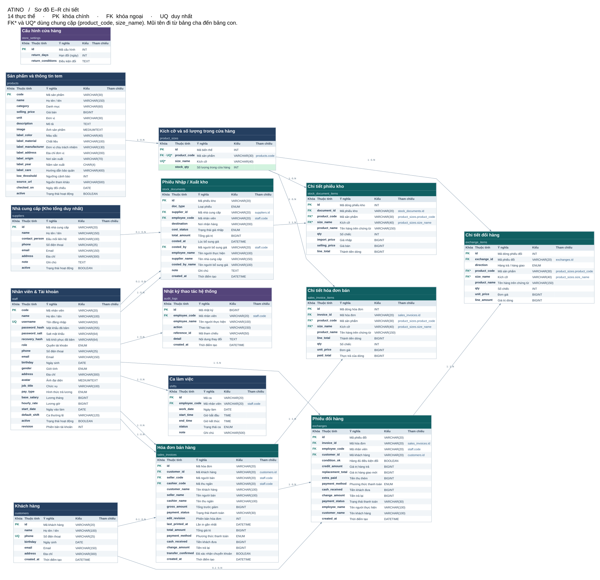

# Atino · Sơ đồ E–R và thuộc tính để duyệt

Bản rà soát ngày 27/11/2026 giữ 12 thực thể nghiệp vụ và 2 thực thể hệ thống. Sơ đồ thể hiện khóa và quan hệ. Từ điển bên dưới liệt kê các thuộc tính. Đây là thiết kế MySQL để duyệt. Bản web local hiện lưu chứng từ trong IndexedDB, gộp nhiều loại chứng từ vào `movements` và lưu các dòng hàng trong `items`.

[Ảnh PNG của bản trước](./erd-atino.png). Sơ đồ Mermaid và từ điển thuộc tính bên dưới đã bổ sung `birthday_discount`.

## 1. Quan hệ giữa các thực thể

```mermaid
erDiagram
    staff ||--o{ shifts : "được phân ca"
    staff ||--o{ stock_documents : "lập phiếu"
    staff |o--o{ stock_documents : "bổ sung giá nhập"
    suppliers |o--o{ stock_documents : "cấp hàng khi nhập"
    stock_documents ||--|{ stock_document_items : "gồm"
    products ||--|{ product_sizes : "có kích cỡ"
    product_sizes ||--o{ stock_document_items : "nhập hoặc xuất"
    customers |o--o{ sales_invoices : "mua hàng"
    staff ||--o{ sales_invoices : "bán hàng"
    staff ||--o{ sales_invoices : "thu ngân"
    sales_invoices ||--|{ sales_invoice_items : "gồm"
    product_sizes ||--o{ sales_invoice_items : "được bán"
    sales_invoices ||--o{ exchanges : "hóa đơn gốc"
    staff ||--o{ exchanges : "lập phiếu đổi"
    customers |o--o{ exchanges : "khách trên hóa đơn gốc"
    exchanges ||--|{ exchange_items : "gồm hàng trả và hàng giao"
    product_sizes ||--o{ exchange_items : "được trả hoặc giao"
    staff ||--o{ audit_logs : "thực hiện"
    staff {
        varchar code PK "Mã"
        varchar name "Họ tên / tên"
        varchar username UK "Tên đăng nhập"
        varchar password_hash "Mật khẩu đã băm"
        varchar password_salt "Salt mật khẩu"
        varchar recovery_hash "Mã khôi phục đã băm"
        enum role "Quyền tài khoản"
        varchar phone "Số điện thoại"
        varchar email "Email"
        date birthday "Ngày sinh"
        enum gender "Giới tính"
        varchar address "Địa chỉ"
        mediumtext avatar "Ảnh đại diện"
        varchar job_title "Chức vụ"
        enum pay_type "Hình thức trả lương"
        bigint base_salary "Lương tháng"
        bigint hourly_rate "Lương giờ"
        date start_date "Ngày vào làm"
        varchar default_shift "Ca thường lệ"
        boolean active "Trạng thái hoạt động"
        int revision "Phiên bản tài khoản"
    }
    shifts {
        varchar id PK "Mã bản ghi"
        varchar employee_code FK "→ staff.code"
        date work_date "Ngày làm"
        time start_time "Giờ bắt đầu"
        time end_time "Giờ kết thúc"
        enum status "Trạng thái ca"
        varchar note "Ghi chú"
    }
    suppliers {
        varchar id PK "Mã bản ghi"
        varchar name "Họ tên / tên"
        varchar contact_person "Đầu mối liên hệ"
        varchar phone "Số điện thoại"
        varchar email "Email"
        varchar address "Địa chỉ"
        text note "Ghi chú"
        boolean active "Trạng thái hoạt động"
    }
    products {
        varchar code PK "Mã"
        varchar name "Họ tên / tên"
        varchar category "Danh mục"
        bigint selling_price "Giá bán"
        varchar unit "Đơn vị"
        text description "Mô tả"
        mediumtext image "Ảnh sản phẩm"
        varchar label_color "Màu sắc"
        varchar label_material "Chất liệu"
        varchar label_manufacturer "Đơn vị chịu trách nhiệm"
        varchar label_address "Địa chỉ đơn vị"
        varchar label_origin "Nơi sản xuất"
        char label_year "Năm sản xuất"
        varchar label_care "Hướng dẫn bảo quản"
        int low_threshold "Ngưỡng cảnh báo"
        varchar source_url "Nguồn tham khảo"
        date checked_on "Ngày đối chiếu"
        boolean active "Trạng thái hoạt động"
    }
    product_sizes {
        int id PK "Mã bản ghi"
        varchar product_code FK "→ products.code"
        varchar size_name "Kích cỡ"
        int stock_qty "Số lượng trong cửa hàng"
    }
    customers {
        varchar id PK "Mã khách hàng"
        varchar name "Họ tên / tên"
        varchar phone UK "Số điện thoại"
        date birthday "Ngày sinh"
        varchar email "Email"
        varchar address "Địa chỉ"
        datetime created_at "Thời điểm tạo"
    }
    stock_documents {
        varchar id PK "Mã bản ghi"
        enum doc_type "Loại phiếu"
        varchar supplier_id FK "→ suppliers.id"
        varchar employee_code FK "→ staff.code"
        varchar destination "Nơi nhận hàng"
        enum cost_status "Trạng thái giá nhập"
        bigint total_amount "Tổng giá trị"
        datetime costed_at "Lúc bổ sung giá"
        varchar costed_by FK "→ staff.code"
        varchar employee_name "Tên người thực hiện"
        varchar supplier_name "Tên nhà cung cấp"
        varchar costed_by_name "Tên người bổ sung giá"
        text note "Ghi chú"
        datetime created_at "Thời điểm tạo"
    }
    stock_document_items {
        int id PK "Mã bản ghi"
        varchar document_id FK "→ stock_documents.id"
        varchar product_code FK "→ product_sizes.product_code"
        varchar size_name FK "→ product_sizes.size_name"
        varchar product_name "Tên hàng trên chứng từ"
        int qty "Số chiếc"
        bigint import_price "Giá nhập"
        bigint selling_price "Giá bán"
        bigint line_total "Thành tiền dòng"
    }
    sales_invoices {
        varchar id PK "Mã bản ghi"
        varchar customer_id FK "→ customers.id"
        varchar seller_code FK "→ staff.code"
        varchar cashier_code FK "→ staff.code"
        varchar customer_name "Tên khách hàng"
        varchar seller_name "Tên người bán"
        varchar cashier_name "Tên thu ngân"
        bigint gross_amount "Tổng trước giảm"
        bigint birthday_discount "Tiền giảm sinh nhật"
        varchar payment_status "Trạng thái thanh toán"
        int edit_revision "Phiên bản hóa đơn"
        datetime last_printed_at "Lần in gần nhất"
        bigint total_amount "Tổng giá trị"
        enum payment_method "Phương thức thanh toán"
        bigint cash_received "Tiền khách đưa"
        bigint change_amount "Tiền trả lại"
        boolean transfer_confirmed "Đã xác nhận chuyển khoản"
        datetime created_at "Thời điểm tạo"
    }
    sales_invoice_items {
        int id PK "Mã bản ghi"
        varchar invoice_id FK "→ sales_invoices.id"
        varchar product_code FK "→ product_sizes.product_code"
        varchar size_name FK "→ product_sizes.size_name"
        varchar product_name "Tên hàng trên chứng từ"
        bigint line_total "Thành tiền dòng"
        int qty "Số chiếc"
        bigint unit_price "Đơn giá"
        bigint paid_total "Thực trả của dòng"
    }
    exchanges {
        varchar id PK "Mã bản ghi"
        varchar invoice_id FK "→ sales_invoices.id"
        varchar employee_code FK "→ staff.code"
        varchar customer_id FK "→ customers.id"
        boolean condition_ok "Hàng đủ điều kiện đổi"
        bigint credit_amount "Giá trị hàng trả"
        bigint replacement_total "Giá trị hàng giao mới"
        bigint extra_paid "Tiền thu thêm"
        enum payment_method "Phương thức thanh toán"
        bigint cash_received "Tiền khách đưa"
        bigint change_amount "Tiền trả lại"
        varchar payment_status "Trạng thái thanh toán"
        varchar employee_name "Tên người thực hiện"
        varchar customer_name "Tên khách hàng"
        datetime created_at "Thời điểm tạo"
    }
    exchange_items {
        int id PK "Mã bản ghi"
        varchar exchange_id FK "→ exchanges.id"
        enum direction "Hàng trả / hàng giao"
        varchar product_code FK "→ product_sizes.product_code"
        varchar size_name FK "→ product_sizes.size_name"
        varchar product_name "Tên hàng trên chứng từ"
        int qty "Số chiếc"
        bigint unit_price "Đơn giá"
        bigint line_amount "Giá trị dòng"
    }
    store_settings {
        int id PK "Mã bản ghi"
        int return_days "Hạn đổi (ngày)"
        text return_conditions "Điều kiện đổi"
    }
    audit_logs {
        bigint id PK "Mã bản ghi"
        varchar employee_code FK "→ staff.code"
        varchar employee_name "Tên người thực hiện"
        varchar action "Thao tác"
        varchar reference_id "Mã tham chiếu"
        text detail "Nội dung thay đổi"
        datetime created_at "Thời điểm tạo"
    }
```

Mỗi nhánh có ký hiệu chân quạ ở đầu “nhiều”. Một hóa đơn có thể bán cho khách lẻ hoặc gắn với một hồ sơ khách hàng. Người bán và thu ngân có thể cùng là một nhân viên. Mỗi phiếu đổi bắt buộc trỏ về một hóa đơn bán. Một hóa đơn có thể được đổi nhiều lần trong giới hạn số chiếc đã mua theo từng mã hàng và cỡ.

Cặp `(product_code, size_name)` ở mỗi dòng chứng từ tham chiếu cặp duy nhất cùng tên ở `product_sizes`. Cấu hình cửa hàng có một bản ghi độc lập. Mã tham chiếu nhật ký thay đổi theo loại thao tác, ví dụ đăng nhập trỏ đến nhân viên, đổi hàng trỏ đến phiếu đổi.

## 2. Tra từ màn hình đến dữ liệu

| Màn hình / thao tác | Khóa và đường đối chiếu | Số liệu cần kiểm tra |
| --- | --- | --- |
| Hồ sơ khách hàng | Mã khách `customers.id` → `sales_invoices.customer_id` → mã hóa đơn | Số đơn chỉ đếm hóa đơn bán. Chi tiêu gồm tiền hóa đơn và tiền thu thêm khi đổi. Ngày mua gần nhất lấy từ hóa đơn bán. |
| Tổng quan, hàng hóa, tem và Excel | Mã sản phẩm → cỡ → các dòng nhập, xuất, bán, đổi → chứng từ | Mã vạch mã hóa mã sản phẩm. Số lượng phân theo cỡ. Xếp loại bán theo số chiếc bán trong tháng, dưới 5 là chậm, từ 5 đến 30 là ổn định, trên 30 là chạy. |
| Nhà cung cấp, nhập kho | `NCC001` → phiếu nhập → người lập → mã hàng và cỡ | Cộng số chiếc nhập. Phiếu chờ giá chưa có giá trị nhập chính thức. Quản lý bổ sung giá và ghi nhận thời điểm. |
| Xuất kho | Mã phiếu xuất → người xuất → nơi nhận → dòng hàng | Trừ số chiếc theo từng cỡ. Nơi nhận và người xuất là hai thuộc tính riêng. |
| Bán hàng, thanh toán, in | Mã hóa đơn → mã khách nếu có → mã người bán, mã thu ngân → dòng hàng | Giá ghi trên hóa đơn là giá tại giao dịch. Tiền khách đưa có thể lớn hơn thực thu. |
| Đổi hàng | Mã phiếu đổi → mã hóa đơn gốc → mã hàng và cỡ đã mua | Phân biệt hàng trả, hàng giao mới, giá trị thực trả được ghi có và chênh lệch đã thu. |
| Nhân viên, ca và lương | Mã nhân viên → ca trong tháng → giờ đã hoàn thành | Cấu hình lương thuộc hồ sơ nhân viên. Tổng giờ và dự toán lương được tính từ dữ liệu của tháng. |
| Nhật ký, sửa hóa đơn | Người thực hiện + ngày giờ + nhóm thao tác → mã chứng từ → chi tiết thay đổi | Giữ nội dung thay đổi để tra cả trước và sau sửa. |
| Góc nhìn nhân viên | Mã tài khoản đang đăng nhập → chứng từ do mình lập → mã hàng → cỡ | Dùng cùng mã chứng từ với quản lý. Nhân viên xem số chiếc và giá bán, giá nhập thuộc quyền quản lý. |

**Số lượng trong cửa hàng.** Mỗi cặp `(product_code, size_name)` có đúng một bản ghi và một số lượng `stock_qty` nguyên không âm. Tổng số lượng của sản phẩm là tổng `stock_qty` của các cỡ.

**Quy ước lưu lịch sử.** Khóa liên kết dùng để tìm hồ sơ. Tên ghi tại thời điểm lập phiếu, giá và số tiền dùng để đọc lại chứng từ kể cả khi hồ sơ hiện tại thay đổi. Các đề xuất về khóa và chỉ mục ở cuối tài liệu dành cho bước triển khai MySQL.

## 3. Từ điển thuộc tính

### A. Nhóm 12 bảng nghiệp vụ chính

#### 1. `staff` — Nhân viên & Tài khoản
- `code` `VARCHAR(20) PRIMARY KEY` — Mã nhân viên (`NV001`)
- `name` `VARCHAR(100) NOT NULL` — Họ và tên
- `username` `VARCHAR(50) NOT NULL UNIQUE` — Tên đăng nhập
- `password_hash` `VARCHAR(255) NOT NULL` — Giá trị băm mật khẩu
- `password_salt` `VARCHAR(64) NOT NULL` — Salt dùng để kiểm tra mật khẩu
- `recovery_hash` `VARCHAR(64) NULL` — Mã khôi phục mật khẩu (băm SHA-256, dùng 1 lần)
- `role` `ENUM('manager', 'employee') NOT NULL` — Quyền tài khoản
- `phone` `VARCHAR(25) NULL` — Số điện thoại
- `email` `VARCHAR(150) NULL` — Email cá nhân
- `birthday` `DATE NULL` — Ngày sinh
- `gender` `ENUM('', 'Nữ', 'Nam', 'Khác') NOT NULL DEFAULT ''` — Giới tính
- `address` `VARCHAR(300) NULL` — Địa chỉ
- `avatar` `MEDIUMTEXT NULL` — Ảnh đại diện
- `job_title` `VARCHAR(100) NULL` — Chức vụ
- `pay_type` `ENUM('monthly', 'hourly') NOT NULL DEFAULT 'monthly'` — Cách tính lương
- `base_salary` `BIGINT NOT NULL DEFAULT 0` — Lương tháng
- `hourly_rate` `BIGINT NOT NULL DEFAULT 0` — Lương theo giờ
- `start_date` `DATE NULL` — Ngày vào làm
- `default_shift` `VARCHAR(120) NULL` — Ca làm thường lệ
- `active` `BOOLEAN NOT NULL DEFAULT TRUE` — Trạng thái hoạt động
- `revision` `INT NOT NULL DEFAULT 1` — Phiên bản tài khoản

#### 2. `shifts` — Ca làm việc
- `id` `VARCHAR(20) PRIMARY KEY` (`CA0001`)
- `employee_code` `VARCHAR(20) NOT NULL` (`FK -> staff.code`)
- `work_date` `DATE NOT NULL` — Ngày làm việc
- `start_time` `TIME NOT NULL` — Giờ bắt đầu
- `end_time` `TIME NOT NULL` — Giờ kết thúc (`end_time > start_time`)
- `status` `ENUM('planned', 'completed') NOT NULL DEFAULT 'planned'` — Trạng thái ca
- `note` `VARCHAR(500) NULL` — Ghi chú

#### 3. `suppliers` — Nhà cung cấp (Kho tổng duy nhất)
- `id` `VARCHAR(20) PRIMARY KEY` (`NCC001`)
- `name` `VARCHAR(150) NOT NULL` — Tên nhà cung cấp
- `contact_person` `VARCHAR(100) NULL` — Người liên hệ
- `phone` `VARCHAR(25) NULL` — Số điện thoại
- `email` `VARCHAR(150) NULL` — Email
- `address` `VARCHAR(300) NULL` — Địa chỉ
- `note` `TEXT NULL` — Ghi chú
- `active` `BOOLEAN NOT NULL DEFAULT TRUE` — Đang hoạt động

#### 4. `products` — Sản phẩm và thông tin tem
- `code` `VARCHAR(30) PRIMARY KEY` (`AT001`, `QJ001`)
- `name` `VARCHAR(150) NOT NULL` — Tên sản phẩm
- `category` `VARCHAR(60) NOT NULL` — Loại sản phẩm
- `selling_price` `BIGINT NOT NULL` — Giá bán niêm yết
- `unit` `VARCHAR(30) NOT NULL DEFAULT 'sản phẩm'` — Đơn vị tính
- `description` `TEXT NULL` — Mô tả sản phẩm
- `image` `MEDIUMTEXT NULL` — Ảnh sản phẩm
- `label_color` `VARCHAR(40) NULL` — Màu sắc (tem nhãn)
- `label_material` `VARCHAR(100) NULL` — Chất liệu (tem nhãn)
- `label_manufacturer` `VARCHAR(130) NULL` — Đơn vị chịu trách nhiệm (tem nhãn)
- `label_address` `VARCHAR(200) NULL` — Địa chỉ đơn vị (tem nhãn)
- `label_origin` `VARCHAR(70) NULL` — Nơi sản xuất (tem nhãn)
- `label_year` `CHAR(4) NULL` — Năm sản xuất (tem nhãn)
- `label_care` `VARCHAR(400) NULL` — Hướng dẫn bảo quản riêng
- `low_threshold` `INT NOT NULL DEFAULT 2` — Ngưỡng cảnh báo sắp hết hàng
- `source_url` `VARCHAR(500) NULL` — Nguồn tham khảo
- `checked_on` `DATE NULL` — Ngày đối chiếu
- `active` `BOOLEAN NOT NULL DEFAULT TRUE` — Đang kinh doanh

#### 5. `product_sizes` — Kích cỡ và số lượng trong cửa hàng
- `id` `INT AUTO_INCREMENT PRIMARY KEY`
- `product_code` `VARCHAR(30) NOT NULL` (`FK -> products.code`)
- `size_name` `VARCHAR(40) NOT NULL` — Tên kích cỡ (`S`, `M`, `L`, `XL`, `39`, `Một cỡ`...)
- `stock_qty` `INT NOT NULL DEFAULT 0` — Số lượng trong cửa hàng của kích cỡ này (`CHECK (stock_qty >= 0)`).
- `UNIQUE KEY uq_product_size (product_code, size_name)`

#### 6. `customers` — Khách hàng
- `id` `VARCHAR(20) PRIMARY KEY` — Mã khách hàng (ví dụ `KH001`, trên web là `customer.id`)
- `name` `VARCHAR(100) NOT NULL` — Họ và tên
- `phone` `VARCHAR(25) NULL UNIQUE` — Số điện thoại
- `birthday` `DATE NULL` — Ngày sinh
- `email` `VARCHAR(150) NULL` — Email
- `address` `VARCHAR(300) NULL` — Địa chỉ
- **Tính khi tra cứu** — tổng chi tiêu, số đơn bán và lần mua gần nhất theo các chứng từ của mã khách.
- `created_at` `DATETIME NOT NULL DEFAULT CURRENT_TIMESTAMP`

#### 7. `stock_documents` — Phiếu Nhập / Xuất kho
- `id` `VARCHAR(20) PRIMARY KEY` (`PN0001` / `XK0001`)
- `doc_type` `ENUM('receipt', 'dispatch') NOT NULL` — Loại phiếu (`receipt` = Nhập, `dispatch` = Xuất)
- `supplier_id` `VARCHAR(20) NULL` (`FK -> suppliers.id`, dùng khi nhập kho)
- `employee_code` `VARCHAR(20) NOT NULL` (`FK -> staff.code`) — Người lập phiếu
- `destination` `VARCHAR(200) NULL` — Nơi nhận hàng ngoài cửa hàng (khi xuất kho)
- `cost_status` `ENUM('pending', 'complete') NOT NULL DEFAULT 'complete'` — Trạng thái giá nhập
- `total_amount` `BIGINT NULL` — Tổng tiền nhập (chỉ Quản lý xem)
- `costed_at` `DATETIME NULL` — Thời điểm bổ sung giá nhập
- `costed_by` `VARCHAR(20) NULL` (`FK -> staff.code`) — Quản lý bổ sung giá nhập
- `employee_name`, `supplier_name`, `costed_by_name` — tên người lập, nhà cung cấp và người hoàn tất giá tại thời điểm ghi phiếu.
- `note` `TEXT NULL` — Ghi chú
- `created_at` `DATETIME NOT NULL DEFAULT CURRENT_TIMESTAMP`

#### 8. `stock_document_items` — Chi tiết phiếu kho
- `id` `INT AUTO_INCREMENT PRIMARY KEY`
- `document_id` `VARCHAR(20) NOT NULL` (`FK -> stock_documents.id`)
- `product_code` `VARCHAR(30) NOT NULL` — Mã sản phẩm, thành phần thứ nhất của khóa ngoại ghép.
- `size_name` `VARCHAR(40) NOT NULL` — Kích cỡ, thành phần thứ hai. Cặp tham chiếu `product_sizes(product_code, size_name)`.
- `product_name` — tên hàng trên phiếu.
- `qty` `INT NOT NULL` (`CHECK (qty > 0)`) — Số lượng
- `import_price` `BIGINT NULL` — Đơn giá nhập (chỉ Quản lý xem/nhập)
- `selling_price` `BIGINT NULL` — Giá bán ghi nhận lúc nhập
- `line_total` `BIGINT NULL` — Thành tiền nhập

#### 9. `sales_invoices` — Hóa đơn bán hàng
- `id` `VARCHAR(20) PRIMARY KEY` (`HD0001`)
- `customer_id` `VARCHAR(20) NULL` (`FK -> customers.id`)
- `seller_code` `VARCHAR(20) NOT NULL` (`FK -> staff.code`) — Người bán (tính doanh thu)
- `cashier_code` `VARCHAR(20) NOT NULL` (`FK -> staff.code`) — Thu ngân (lập hóa đơn & thu tiền)
- `customer_name`, `seller_name`, `cashier_name` — tên trên hóa đơn.
- `gross_amount` — tổng thành tiền các dòng theo giá niêm yết trước khi giảm.
- `birthday_discount` `BIGINT NULL` — số tiền đã giảm sinh nhật, bằng `0` khi hóa đơn mới không phát sinh giảm. Để `NULL` cho hóa đơn cũ trước khi áp dụng chính sách. Khi chuyển dữ liệu web, dùng `birthdayPricing` để phân biệt và lấy số tiền từ `discount`.
- `payment_status` — tình trạng thanh toán.
- `edit_revision` — phiên bản hóa đơn để phát hiện hai người cùng sửa.
- `last_printed_at` — thời điểm bấm in gần nhất, để trống nếu chưa in.
- `total_amount` `BIGINT NOT NULL` — Tổng tiền thanh toán sau giảm, bằng tổng `paid_total` của các dòng.
- `payment_method` `ENUM('Tiền mặt', 'Chuyển khoản') NOT NULL` — Phương thức thanh toán
- `cash_received` `BIGINT NULL` — Tiền khách đưa
- `change_amount` `BIGINT NOT NULL DEFAULT 0` — Tiền thối lại
- `transfer_confirmed` `BOOLEAN NOT NULL DEFAULT FALSE` — Đã xác nhận chuyển khoản
- `created_at` `DATETIME NOT NULL DEFAULT CURRENT_TIMESTAMP`

#### 10. `sales_invoice_items` — Chi tiết hóa đơn bán
- `id` `INT AUTO_INCREMENT PRIMARY KEY`
- `invoice_id` `VARCHAR(20) NOT NULL` (`FK -> sales_invoices.id`)
- `product_code` `VARCHAR(30) NOT NULL` — Mã sản phẩm, thành phần thứ nhất của khóa ngoại ghép.
- `size_name` `VARCHAR(40) NOT NULL` — Kích cỡ, thành phần thứ hai. Cặp tham chiếu `product_sizes(product_code, size_name)`.
- `product_name` — tên hàng lúc bán.
- `line_total` — thành tiền theo giá bán lúc lập. Đối chiếu với `paid_total` khi xử lý đổi.
- `qty` `INT NOT NULL` (`CHECK (qty > 0)`) — Số lượng
- `unit_price` `BIGINT NOT NULL` — Đơn giá bán
- `paid_total` `BIGINT NOT NULL` — Tiền thực trả của dòng (dùng khi đổi hàng)

#### 11. `exchanges` — Phiếu đổi hàng
- `id` `VARCHAR(20) PRIMARY KEY` (`DT0001`)
- `invoice_id` `VARCHAR(20) NOT NULL` (`FK -> sales_invoices.id`) — Hóa đơn gốc (trong 30 ngày)
- `employee_code` `VARCHAR(20) NOT NULL` (`FK -> staff.code`) — Người lập phiếu đổi
- `customer_id` `VARCHAR(20) NULL` (`FK -> customers.id`) — Khách hàng
- `condition_ok` `BOOLEAN NOT NULL DEFAULT TRUE` (`CHECK (condition_ok = TRUE)`) — Chỉ nhận hàng nguyên vẹn
- `credit_amount` `BIGINT NOT NULL` — Giá trị hàng trả lại
- `replacement_total` `BIGINT NOT NULL` (`CHECK (replacement_total >= credit_amount)`) — Giá trị hàng lấy mới
- `extra_paid` `BIGINT NOT NULL` — Tiền thu thêm (`>= 0`)
- `payment_method` `ENUM('Tiền mặt', 'Chuyển khoản') NOT NULL` — Hình thức thu thêm
- `cash_received` `BIGINT NULL` — Tiền khách đưa
- `change_amount`, `payment_status` — tiền trả lại và tình trạng thanh toán chênh lệch.
- `employee_name`, `customer_name` — tên trên chứng từ.
- `created_at` `DATETIME NOT NULL DEFAULT CURRENT_TIMESTAMP`

#### 12. `exchange_items` — Chi tiết đổi hàng
- `id` `INT AUTO_INCREMENT PRIMARY KEY`
- `exchange_id` `VARCHAR(20) NOT NULL` (`FK -> exchanges.id`)
- `direction` `ENUM('returned', 'replacement') NOT NULL` — `returned` (khách trả cộng kho) / `replacement` (lấy mới trừ kho)
- `product_code` `VARCHAR(30) NOT NULL` — Mã sản phẩm, thành phần thứ nhất của khóa ngoại ghép.
- `size_name` `VARCHAR(40) NOT NULL` — Kích cỡ, thành phần thứ hai. Cặp tham chiếu `product_sizes(product_code, size_name)`.
- `product_name` — tên hàng lúc đổi. Với hàng trả, `line_amount` là giá trị được ghi có theo thực trả và số chiếc đã đổi trước đó.
- `qty` `INT NOT NULL` (`CHECK (qty > 0)`) — Số lượng
- `unit_price` `BIGINT NOT NULL` — Đơn giá
- `line_amount` `BIGINT NOT NULL` — Thành tiền dòng

---

### B. Nhóm 2 bảng hệ thống hỗ trợ

#### 13. `store_settings` — Cấu hình cửa hàng
- `id` `INT PRIMARY KEY DEFAULT 1`
- `return_days` `INT NOT NULL DEFAULT 30` — Thời hạn đổi hàng (30 ngày)
- `return_conditions` `TEXT NOT NULL` — Nội dung điều kiện kiểm tra hàng đổi

#### 14. `audit_logs` — Nhật ký thao tác hệ thống
- `id` `BIGINT AUTO_INCREMENT PRIMARY KEY`
- `employee_code` `VARCHAR(20) NOT NULL` (`FK -> staff.code`)
- `employee_name` `VARCHAR(100) NOT NULL`
- `action` `VARCHAR(150) NOT NULL` — Tên hành động
- `reference_id` `VARCHAR(50) NOT NULL` — Mã chứng từ / đối tượng tham chiếu
- `detail` `TEXT NULL` — tóm tắt trước và sau khi sửa. Nhóm bộ lọc được xác định từ hành động đã lưu.
- `created_at` `DATETIME NOT NULL DEFAULT CURRENT_TIMESTAMP`

## 4. Khóa và chỉ mục đề xuất để tra cứu

- Khách hàng dùng mã KH làm khóa chính và tra thêm theo tên, số điện thoại. Khách lẻ để trống liên kết khách hàng trong hóa đơn.
- Hóa đơn cần chỉ mục theo (mã khách, ngày lập), (người bán, ngày lập) và (thu ngân, ngày lập). Phiếu kho cần (loại phiếu, ngày lập), (nhà cung cấp, ngày lập) và (người lập, ngày lập).
- Tra hạn mức ưu đãi bằng tổng `birthday_discount` của các hóa đơn theo (mã khách, ngày lập, giờ Việt Nam). Khi sửa hóa đơn, dùng ngày lập ban đầu và bỏ hóa đơn đang sửa khỏi tổng đã dùng.
- Tra lịch sử sản phẩm bằng (mã sản phẩm, cỡ) trên từng bảng chi tiết. Tra đổi trả bằng mã hóa đơn gốc trên phiếu đổi. Tra nhật ký bằng mã tham chiếu và cặp (người thực hiện, ngày giờ).
- Đề xuất lưu mã yêu cầu khi lập phiếu, hóa đơn và phiếu đổi, duy nhất theo người lập và loại nghiệp vụ, để tra hoặc nhận lại kết quả khi gửi lại cùng yêu cầu. Web hiện dùng requestId và chữ ký nội dung.
